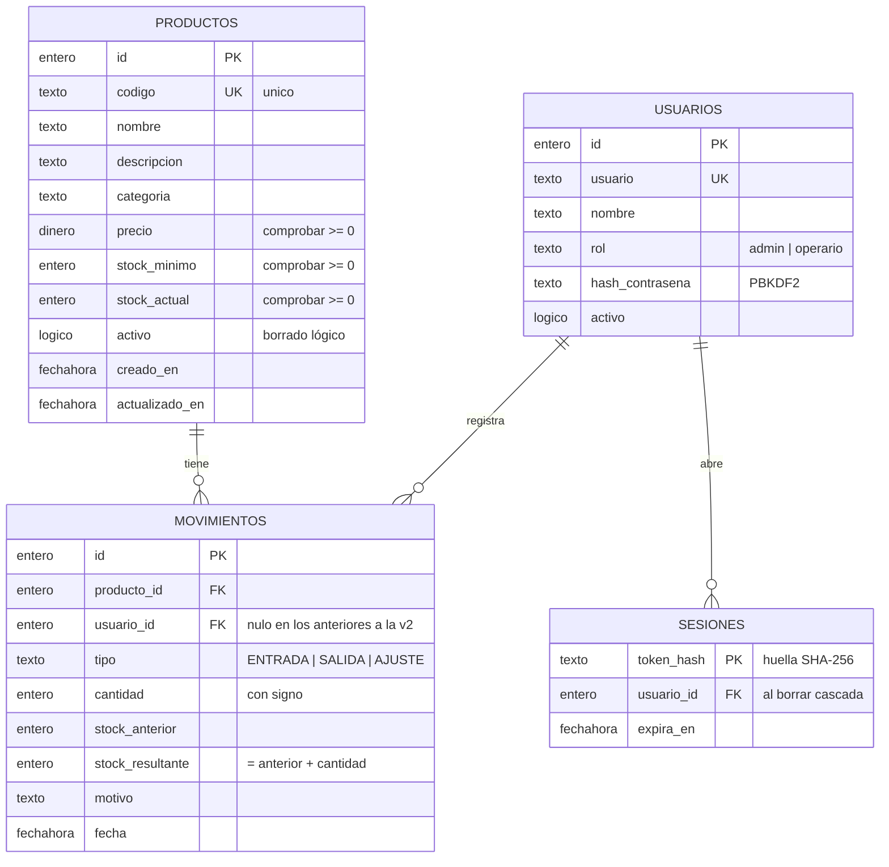

# Gestor de inventario

Aplicación para **registrar productos, controlar sus entradas y salidas y consultar las existencias**.
Ejercicio de «milla extra» de la asignatura de Acceso a Datos.

- **Base de datos: [SBD](sbd/LEEME-SBD.md)**, un motor de bases de datos propio con **lenguaje en español** (no SQL), escrito desde cero en Python. Va incluido en la carpeta `sbd/` (versión 3.1.1), así que no hay que instalar nada.
- **Backend:** Python 3.11+ con `http.server` y SBD. Sin más dependencias.
- **Frontend:** HTML, CSS y JavaScript sin frameworks, servidos por el propio programa. La nave 3D usa [Three.js](https://threejs.org) r170 (licencia MIT), incluido en `static/vendor/three` para que funcione sin internet; solo se descarga al abrir la vista 3D.

## Cómo ejecutarlo

```bash
python3 app.py                  # la primera vez carga el material de ejemplo
python3 app.py --sin-ejemplos   # base vacía con un administrador inicial (contraseña aleatoria en la consola)
```

Después, abre <http://127.0.0.1:8000>. Si ese puerto está ocupado, el programa usa el siguiente libre y te lo indica. Otras opciones: `--puerto 9000`, `--datos otra/carpeta` y `--abrir`, que abre el navegador.

Los datos se guardan en `datos/inventario.base` (con su diario `inventario.diario` mientras el programa está en marcha). Para empezar de cero, borra la carpeta `datos/`.

La aplicación pide **iniciar sesión**. Con el material de ejemplo hay dos usuarios (aparecen también en la pantalla de acceso):

| Usuario | Contraseña | Rol | Puede |
|---|---|---|---|
| `laura` | `almacen2026` | Administración | Todo: dar de alta, editar y dar de baja referencias, y registrar movimientos |
| `diego` | `almacen2026` | Operario | Consultar y registrar entradas, salidas y recuentos |

El material de ejemplo son 28 referencias en 6 categorías con unos 45 días de historial (más de 500 movimientos con su fecha y su autor), con referencias en stock, bajo mínimo y agotadas.

Para pasar las pruebas automáticas (38 tests):

```bash
python3 -m unittest discover -s tests -v
```

### Ver los datos con SBD

Con el inventario parado, la consola y el panel de SBD abren la misma carpeta:

```bash
python3 -m sbd datos -b inventario      # consola: buscar v_existencias donde estado != "OK"
python3 -m sbd servidor datos --abrir   # panel web de SBD en http://127.0.0.1:8080
```

En la consola, `historial de inventario` enseña cada cambio firmado por quien lo hizo («inventario · laura»). Mientras el inventario está en marcha, SBD bloquea la carpeta para que nadie más escriba en ella a la vez.

### Contra un servidor de SBD

El inventario también puede trabajar contra un `sbd servidor` en marcha, como cualquier aplicación contra su servidor de datos. Así el inventario y el panel de SBD funcionan a la vez sobre la misma base. Una vez, en la carpeta de datos del servidor:

```
crear base inventario
crear usuario app_inventario clave "una clave larga" puede escribir en inventario
crear clave api para app_inventario llamada "gestor de inventario"     -- copia la clave: se ve una sola vez
```

Y luego:

```bash
python3 -m sbd servidor datos-sbd --puerto 8095
SBD_CLAVE=sbd_… python3 app.py --sbd-servidor http://127.0.0.1:8095
```

La primera vez, el inventario crea sus tablas (con sus migraciones) y el material de ejemplo a través de la API de SBD.

## Recorrido «Del muelle al Kardex» (para presentar)

Abre <http://127.0.0.1:8000/recorrido.html> (no pide sesión; la aplicación no enlaza a él). Es una portada en 3D en la que el scroll mueve la cámara: vuela por una maqueta del almacén y se zambulle en cinco escenas (muelle, recepción, estanterías, expedición y oficina Kardex), cada una con el concepto de acceso a datos que ilustra (transacciones, `unico`, `comprobar`, historial que solo crece…). Las escenas reaccionan al scroll: el palé sale del camión, el sello baja sobre el albarán, caen cajas en un hueco agotado y su etiqueta cambia, la carretilla sale por el muelle y la tarjeta Kardex se rellena.

Todo se genera en tiempo real con Three.js: no usa vídeos ni imágenes generadas, no cuesta nada y funciona sin internet. Tiene encuadre propio para móvil en vertical y, con «reducir movimiento» activado en el sistema, muestra planos fijos en lugar del vuelo.

## Qué se puede hacer

La interfaz está planteada como la nave de un almacén: los pasillos son las secciones, cada referencia tiene su etiqueta de estantería y cada movimiento es un albarán.

| Función | Dónde |
|---|---|
| **La nave en 3D** (pantalla de inicio): cada categoría es un pasillo con su estantería y cada referencia un hueco con un palé y tantas cajas como stock; al registrar una entrada caen cajas nuevas y con una salida se van. Se puede girar, acercar y pulsar un hueco para abrir su tarjeta Kardex | 01 · Nave |
| Panel con unidades, valor del stock, avisos de reposición, lista «Para reponer» con reposición en un clic y ticket con los últimos movimientos | 02 · Panel |
| Dar de alta referencias (con **vista previa en vivo de la etiqueta**), editarlas y darlas de baja | 03 · Existencias → «Nueva referencia» |
| Consultar las existencias como **etiquetas de estantería** (con código de barras Code 128 real) o como lista, con búsqueda y filtros por categoría y por estado | 03 · Existencias |
| Registrar **entradas**, **salidas** y **recuentos** en un albarán que muestra el saldo resultante antes de confirmar y se sella con su número al registrarse | Botón amarillo «Registrar movimiento» o los botones de cada etiqueta |
| **Tarjeta Kardex** de cada referencia (entradas, salidas, saldo y quién lo registró) e **impresión de su etiqueta** | Pulsando el nombre de una referencia |
| Libro de movimientos con columnas de entrada, salida y saldo, filtrable por referencia y tipo | 04 · Movimientos |
| Exportar las existencias a CSV (se abre directamente en Excel) | 03 · Existencias → «Exportar CSV» |

Atajos de teclado: <kbd>M</kbd> registra un movimiento, <kbd>N</kbd> crea una referencia y <kbd>/</kbd> lleva al buscador. Tiene modo claro y oscuro, y se adapta al móvil.

## Arquitectura

```
Navegador (static/)            index.html · css/estilos.css · js/app.js
      │  fetch() JSON
      ▼
API REST (inventario/api.py)   rutas, sesión, permisos y ficheros estáticos
      │
      ▼
Servicios (servicio.py, cuentas.py)   validación, reglas de negocio y transacciones
      │
      ▼
DAO (producto_dao.py, movimiento_dao.py, usuario_dao.py)   todas las órdenes SBD
      │
      ▼
Conexión (bd.py)               SBD local (sbd.Servidor) o remoto (sbd.Cliente)
      │
      ▼
SBD (migraciones/*.sbd)        tablas, restricciones, índices y una vista
```

Cada capa solo conoce a la de debajo. Los DAO no saben si SBD corre dentro del programa o en otro servidor: solo usan `ejecutar`, `consultar` y `transaccion` de `bd.py`. El servicio no sabe nada de HTTP, así que los tests lo usan directamente contra una carpeta de SBD temporal.

### Modelo de datos



La vista **`v_existencias`** añade a cada producto su `estado` (`OK`, `BAJO` o `AGOTADO`, con `caso … fin`) y su `valor` (stock × precio, en `dinero`). La aplicación consulta las existencias siempre a través de ella. Además hay una tabla `ajustes` (clave-valor) con la versión del esquema.

## Decisiones de acceso a datos (la «milla extra»)

1. **Transacciones explícitas.** Registrar un movimiento son dos escrituras: actualizar `productos.stock_actual` e insertar en `movimientos`. Las dos van dentro de `empezar … confirmar`, y si algo falla se hace `deshacer` ([bd.py](inventario/bd.py)). Las peticiones se atienden de una en una, igual que el servidor de SBD, así que dos peticiones no pueden leer el mismo stock y pisarse.
2. **Control de concurrencia optimista.** El `actualizar` del stock lleva `donde stock_actual = <valor leído>`. Si no cambia ninguna fila, alguien lo cambió antes y se aborta.
3. **Parámetros siempre.** Ningún valor del usuario se pega al texto de la orden: todos van como parámetros `?`. Las búsquedas usan `contiene`, que busca el texto tal cual, así que «50%» encuentra literalmente «50%».
4. **La base de datos se defiende sola.** Aunque la aplicación tuviera un fallo, SBD rechaza el stock negativo, los códigos repetidos, los movimientos de productos inexistentes y los movimientos incoherentes (`comprobar`, `unico`, `->`). Hay tests que lo comprueban saltándose la aplicación.
5. **Historial que solo crece.** SBD todavía no tiene disparadores, así que esta regla la garantiza el programa: `MovimientoDAO` solo sabe insertar y consultar, y no hay ninguna orden `actualizar movimientos` ni `borrar de movimientos` en todo el código. Gracias a eso se cumple siempre que *stock actual = suma de todas las cantidades de sus movimientos*, y hay un test que lo verifica. Por la misma razón, `actualizado_en` lo pone cada `actualizar` del DAO con `ahora()`.
6. **Borrado lógico.** Un producto con historial no se borra: se marca `activo = falso` y sus movimientos se conservan.
7. **Dinero exacto.** Los precios son del tipo `dinero` de SBD: dos decimales exactos, sin errores de coma flotante. En Python se validan con `Decimal`.
8. **Migraciones del esquema** (`inventario/migraciones/001_inicial.sbd`, `002_usuarios.sbd`), escritas en SBD. La versión se guarda en la tabla `ajustes` y cada migración se aplica en su propia transacción, junto con el cambio de versión. Una base de la versión 1 se actualiza sola a la 2 al arrancar, sin perder datos: la 2 añade las tablas de usuarios y sesiones y la columna `movimientos.usuario_id` con `añadir a`.
9. **Auditoría.** SBD anota cada orden que cambia algo. El inventario firma sus cambios con el usuario que ha iniciado sesión, así que `historial de inventario` dice quién hizo cada cosa.
10. **Usuarios y sesiones** (`cuentas.py`, `seguridad.py`):
    - Contraseñas con PBKDF2-SHA256 (600 000 iteraciones y sal aleatoria), comparadas en tiempo constante.
    - Mismo mensaje y mismo tiempo de respuesta tanto si el usuario no existe como si la contraseña es incorrecta, y bloqueo tras 5 intentos fallidos.
    - En la tabla `sesiones` se guarda la **huella SHA-256 del token**, no el token, y la caducidad se calcula en SBD (`ahora() + horas(8)`).
    - La cookie es `HttpOnly` y `SameSite=Strict`, y las escrituras solo aceptan JSON (protección CSRF).
    - Los roles se comprueban en el servidor (403), no solo ocultando botones.
11. **CSV seguro:** separador `;` y BOM UTF-8 para que Excel en español lo abra bien, y protección contra la inyección de fórmulas (`=`, `+`, `-`, `@`).

## API REST

| Método | Ruta | Descripción |
|---|---|---|
| GET · POST · DELETE | `/api/sesion` | Quién ha entrado · iniciar sesión · salir |
| GET | `/api/resumen` | Totales, actividad de hoy, alertas y últimos movimientos |
| GET | `/api/productos?q=&categoria=&estado=` | Existencias filtradas (`estado`: `OK`, `BAJO`, `AGOTADO` o `ALERTA`) |
| POST | `/api/productos` | Alta (admite `stock_inicial`) → `201`. Solo administración |
| GET / PUT / DELETE | `/api/productos/{id}` | Consultar, modificar o dar de baja (`204`). Cambiar, solo administración |
| GET | `/api/categorias` | Categorías con el número de productos de cada una |
| GET | `/api/movimientos?producto_id=&tipo=&limite=` | Historial |
| POST | `/api/movimientos` | `{producto_id, tipo, cantidad, motivo}` → `201`. En `AJUSTE`, `cantidad` es el recuento físico |
| GET | `/api/exportar/existencias.csv` | Descarga en CSV |

Los errores devuelven `{"error": "mensaje", "campo": "nombre_del_campo"}` con el código adecuado: `400` si los datos no son válidos, `401` sin sesión, `403` sin permiso, `404` si no existe, `409` si hay un conflicto (código repetido o stock insuficiente) y `503` si la base está ocupada.

## Estructura

```
gestor-inventario/
├── app.py                  punto de entrada
├── inventario/
│   ├── migraciones/        001_inicial.sbd (tablas, índices, vista) · 002_usuarios.sbd
│   ├── bd.py               conexión con SBD (local o servidor), transacciones y migraciones
│   ├── cuentas.py          usuarios, inicio de sesión y sesiones
│   ├── seguridad.py        cifrado de contraseñas y tokens
│   ├── usuario_dao.py      órdenes SBD de usuarios, sesiones y ajustes
│   ├── producto_dao.py     órdenes SBD de productos y existencias
│   ├── movimiento_dao.py   órdenes SBD de movimientos
│   ├── servicio.py         reglas de negocio
│   ├── validacion.py       validación de los datos de entrada
│   ├── errores.py          excepciones → códigos HTTP
│   ├── api.py              servidor HTTP y rutas REST
│   └── demo.py             material de ejemplo (referencias, usuarios e historial)
├── sbd/                    el motor SBD (copia de la versión 3.1.1, con su consola y su panel)
├── static/                 frontend (js/app.js · js/nave.js 3D · js/code128.js · vendor/three)
├── datos/                  se crea al arrancar: inventario.base
└── tests/                  pruebas unitarias y de integración
```

## Posibles ampliaciones

- Proveedores y pedidos de compra que generen entradas automáticamente.
- Varios almacenes, con traspasos entre ellos.
- Coste medio ponderado del stock a partir del precio de cada entrada.
- Pantalla de administración de usuarios (ahora se crean desde código).
- Cuando SBD tenga disparadores, mover a la base la regla del historial que solo crece.
