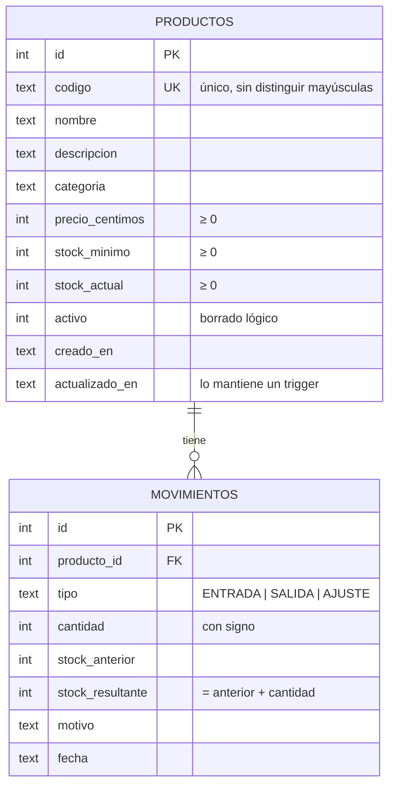

# Gestor de inventario

Aplicación para **registrar productos, controlar sus entradas y salidas y consultar las existencias**.
Ejercicio de «milla extra» de la asignatura de Acceso a Datos.

- **Backend:** Python 3.10+ con `sqlite3` y `http.server`, solo con la biblioteca estándar y **sin dependencias que instalar**.
- **Base de datos:** SQLite, en un único fichero `inventario.db`.
- **Frontend:** HTML, CSS y JavaScript sin frameworks, servidos por el propio programa. La nave 3D usa [Three.js](https://threejs.org) r170 (licencia MIT), incluido en `static/vendor/three` para que funcione sin internet; solo se descarga al abrir la vista 3D.

## Cómo ejecutarlo

```bash
python app.py                  # la primera vez carga el material de ejemplo
python app.py --sin-ejemplos   # base de datos vacía con un administrador inicial (contraseña aleatoria en la consola)
```

La aplicación pide **iniciar sesión**. Con el material de ejemplo hay dos usuarios (aparecen también en la pantalla de acceso):

| Usuario | Contraseña | Rol | Puede |
|---|---|---|---|
| `laura` | `almacen2026` | Administración | Todo: dar de alta, editar y dar de baja referencias, y registrar movimientos |
| `diego` | `almacen2026` | Operario | Consultar y registrar entradas, salidas y recuentos |

El material de ejemplo son 28 referencias en 6 categorías con unos 45 días de historial (más de 500 movimientos con su fecha y su autor), con referencias en stock, bajo mínimo y agotadas. Para empezar de cero, borra `inventario.db`.

Después, abre <http://127.0.0.1:8000>. Si ese puerto está ocupado, el programa usa el siguiente libre y te lo indica. Otras opciones: `--puerto 9000`, `--bd otra.db` y `--abrir`, que abre el navegador.

Para pasar las pruebas automáticas (36 tests):

```bash
python -m unittest discover -s tests -v
```

## Recorrido «Del muelle al Kardex» (para presentar)

Abre <http://127.0.0.1:8000/recorrido.html> (no pide sesión; la aplicación no enlaza a él). Es una portada en 3D en la que el scroll mueve la cámara: vuela por una maqueta del almacén y se zambulle en cinco escenas (muelle, recepción, estanterías, expedición y oficina Kardex), cada una con el concepto de acceso a datos que ilustra (transacciones, `UNIQUE`, `CHECK`, triggers…). Las escenas reaccionan al scroll: el palé sale del camión, el sello baja sobre el albarán, caen cajas en un hueco agotado y su etiqueta cambia, la carretilla sale por el muelle y la tarjeta Kardex se rellena. El cierre muestra las cifras reales de la base de datos y lleva a la aplicación.

Todo se genera en tiempo real con Three.js: no usa vídeos ni imágenes generadas, no cuesta nada y funciona sin internet. Tiene encuadre propio para móvil en vertical y, con «reducir movimiento» activado en el sistema, muestra planos fijos en lugar del vuelo.

## Qué se puede hacer

La interfaz está planteada como la nave de un almacén: los pasillos son las secciones, cada referencia tiene su etiqueta de estantería y cada movimiento es un albarán.

| Función | Dónde |
|---|---|
| **La nave en 3D** (pantalla de inicio): cada categoría es un pasillo con su estantería y cada referencia un hueco con un palé y tantas cajas como stock; al registrar una entrada caen cajas nuevas y con una salida se van. Se puede girar, acercar y pulsar un hueco para abrir su tarjeta Kardex | 01 · Nave |
| Panel con unidades, valor del stock, avisos de reposición, lista «Para reponer» con reposición en un clic y ticket con los últimos movimientos | 02 · Panel |
| Dar de alta referencias (con **vista previa en vivo de la etiqueta**), editarlas y darlas de baja | 03 · Existencias → «Nueva referencia» |
| Consultar las existencias como **etiquetas de estantería** (con código de barras Code 128 real) o como lista, con búsqueda y filtros por categoría y por estado | 03 · Existencias |
| Registrar **entradas**, **salidas** y **recuentos** en un albarán que muestra el saldo resultante antes de confirmar y se sella con su número al registrarse | Botón amarillo «Registrar movimiento» o los botones de cada etiqueta |
| **Tarjeta Kardex** de cada referencia (entradas, salidas y saldo) e **impresión de su etiqueta** | Pulsando el nombre de una referencia |
| Libro de movimientos con columnas de entrada, salida y saldo, filtrable por referencia y tipo | 04 · Movimientos |
| Exportar las existencias a CSV (se abre directamente en Excel) | 03 · Existencias → «Exportar CSV» |

Atajos de teclado: <kbd>M</kbd> registra un movimiento, <kbd>N</kbd> crea una referencia y <kbd>/</kbd> lleva al buscador. Tiene modo claro y oscuro, y se adapta al móvil.

## Arquitectura

```
Navegador (static/)            index.html · css/estilos.css · js/app.js
      │  fetch() JSON
      ▼
API REST (inventario/api.py)   rutas, códigos HTTP y ficheros estáticos
      │
      ▼
Servicio (servicio.py)         validación, reglas de negocio y transacciones
      │
      ▼
DAO (producto_dao.py, movimiento_dao.py)   todo el SQL
      │
      ▼
SQLite (migraciones/*.sql)     tablas, restricciones, triggers y una vista
```

Cada capa solo conoce a la de debajo. El servicio no sabe nada de HTTP, así que los tests lo usan directamente contra una base de datos en memoria (`:memory:`).

### Modelo de datos



La vista **`v_existencias`** añade a cada producto su `estado` (`OK`, `BAJO` o `AGOTADO`) y su `valor` (stock × precio). La aplicación consulta las existencias siempre a través de ella.

## Decisiones de acceso a datos (la «milla extra»)

1. **Transacciones explícitas.** Registrar un movimiento son dos escrituras: actualizar `productos.stock_actual` e insertar en `movimientos`. Las dos van dentro de `BEGIN IMMEDIATE … COMMIT`, y si algo falla se hace `ROLLBACK` ([conexion.py](inventario/conexion.py)). `IMMEDIATE` reserva el bloqueo de escritura desde el principio, así dos peticiones simultáneas no pueden leer el mismo stock y pisarse.
2. **Control de concurrencia optimista.** El `UPDATE` del stock lleva `WHERE stock_actual = <valor leído>`. Si no actualiza ninguna fila, alguien lo cambió antes y se aborta.
3. **Sentencias preparadas siempre.** Ningún valor del usuario se concatena en el SQL; todos van como parámetros `?` o `:nombre`. En las búsquedas `LIKE` además se escapan `%` y `_`, para que buscar «50%» encuentre literalmente «50%».
4. **La base de datos se defiende sola.** Aunque la aplicación tuviera un fallo, SQLite rechaza el stock negativo, los códigos duplicados, los movimientos de productos inexistentes y los movimientos incoherentes (`CHECK`, `UNIQUE`, `FOREIGN KEY`). Hay tests que lo comprueban saltándose la aplicación.
5. **Historial inmutable.** Dos triggers impiden hacer `UPDATE` o `DELETE` sobre `movimientos`. Gracias a eso se cumple siempre que *stock actual = suma de todas las cantidades de sus movimientos*, y hay un test que lo verifica. El stock inicial de un producto también se registra como una entrada.
6. **Borrado lógico.** Un producto con historial no se borra: se marca `activo = 0` y sus movimientos se conservan.
7. **Dinero en céntimos.** Los precios se guardan como enteros (`precio_centimos`) para evitar los errores de redondeo de `REAL`, y se convierten con `Decimal`.
8. **Migraciones del esquema** (`inventario/migraciones/001_inicial.sql`, `002_usuarios.sql`). `PRAGMA user_version` guarda la versión dentro del propio fichero y cada migración se aplica en su propia transacción junto con el cambio de versión: una base de datos de la versión 1 se actualiza sola a la 2 al arrancar, sin perder datos.
9. **Una conexión por petición** (el servidor atiende varias a la vez con hilos), `PRAGMA foreign_keys = ON` (SQLite no comprueba las claves ajenas si no se activa) y modo `WAL` para poder leer mientras se escribe.
10. **Usuarios y sesiones** (`cuentas.py`, `seguridad.py`): contraseñas con PBKDF2-SHA256 (600 000 iteraciones y sal aleatoria), comparación en tiempo constante, mismo mensaje y mismo tiempo de respuesta tanto si el usuario no existe como si la contraseña es incorrecta, y bloqueo tras 5 intentos fallidos. En la tabla `sesiones` se guarda la **huella SHA-256 del token**, no el token. La cookie es `HttpOnly` y `SameSite=Strict`, y las escrituras solo aceptan JSON (protección CSRF). Los roles se comprueban en el servidor (403), no solo ocultando botones. Cada movimiento guarda su autor (`usuario_id`, clave ajena a `usuarios`).
11. **CSV seguro:** separador `;` y BOM UTF-8 para que Excel en español lo abra bien, y protección contra la inyección de fórmulas (`=`, `+`, `-`, `@`).

## API REST

| Método | Ruta | Descripción |
|---|---|---|
| GET | `/api/resumen` | Totales, actividad de hoy, alertas y últimos movimientos |
| GET | `/api/productos?q=&categoria=&estado=` | Existencias filtradas (`estado`: `OK`, `BAJO`, `AGOTADO` o `ALERTA`) |
| POST | `/api/productos` | Alta (admite `stock_inicial`) → `201` |
| GET / PUT / DELETE | `/api/productos/{id}` | Consultar, modificar o dar de baja (`204`) |
| GET | `/api/categorias` | Categorías con el número de productos de cada una |
| GET | `/api/movimientos?producto_id=&tipo=&limite=` | Historial |
| POST | `/api/movimientos` | `{producto_id, tipo, cantidad, motivo}` → `201`. En `AJUSTE`, `cantidad` es el recuento físico |
| GET | `/api/exportar/existencias.csv` | Descarga en CSV |

Los errores devuelven `{"error": "mensaje", "campo": "nombre_del_campo"}` con el código adecuado: `400` si los datos no son válidos, `404` si no existe y `409` si hay un conflicto, como un código duplicado o un stock insuficiente.

## Estructura

```
gestor-inventario/
├── app.py                  punto de entrada
├── inventario/
│   ├── migraciones/        001_inicial.sql (tablas, triggers, vista) · 002_usuarios.sql
│   ├── conexion.py         conexión, migraciones y transacciones
│   ├── cuentas.py          usuarios, inicio de sesión y sesiones
│   ├── seguridad.py        cifrado de contraseñas y tokens
│   ├── usuario_dao.py      SQL de usuarios, sesiones y ajustes
│   ├── producto_dao.py     SQL de productos y existencias
│   ├── movimiento_dao.py   SQL de movimientos
│   ├── servicio.py         reglas de negocio
│   ├── validacion.py       validación de los datos de entrada
│   ├── errores.py          excepciones → códigos HTTP
│   ├── api.py              servidor HTTP y rutas REST
│   └── demo.py             material de ejemplo (referencias, usuarios e historial)
├── static/                 frontend (js/app.js · js/nave.js 3D · js/code128.js · vendor/three)
└── tests/                  pruebas unitarias y de integración
```

## Posibles ampliaciones

- Proveedores y pedidos de compra que generen entradas automáticamente.
- Varios almacenes, con traspasos entre ellos.
- Coste medio ponderado del stock a partir del precio de cada entrada.
- Pantalla de administración de usuarios (ahora se crean desde código).
- Cambiar SQLite por MySQL o PostgreSQL: solo afecta a `conexion.py` y a algunos detalles de SQL de los DAO.
